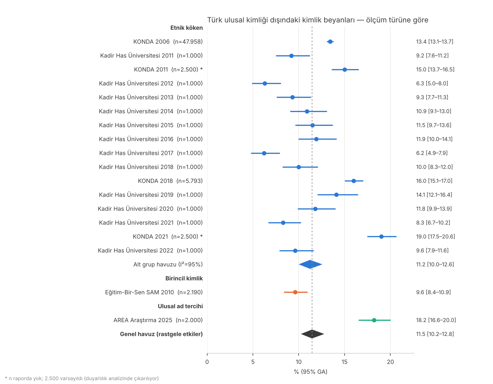

# National Identity Declarations in Turkey: A Meta-Analysis (2006–2025)

A reproducible random-effects meta-analysis of 18 independent survey samples from 5 institutions (Kadir Has University, KONDA, Eğitim-Bir-Sen, AREA) on the share of respondents who declare an identity outside the Turkish national identity (Kurdish/Zaza ethnicity, Kurdish/Alevi primary identity, or "Türkiyeli" as a national label).

**Key results**
- Pooled share: **11.5%** (95% CI 10.2–12.8), very high heterogeneity (I² = 95%).
- **No time trend** 2006–2025 (p = 0.71).
- Differences are driven by **survey house and question wording**, not time: KONDA measures ~1.8× higher odds than Kadir Has. Asking for a national label ("Türkiyeli") yields **18.2%**.
- "Türkiyeli" preference (AREA 2025) exceeds the recent ethnic Kurdish/Zaza estimate by **5.8 points** (p < 0.001).
- In the Kadir Has series, swings in "Turkish" self-identification track non-response (r = −0.99), not alternative identities (r = 0.13).

Full write-up: [`REPORT_EN.md`](REPORT_EN.md) (English) · [`REPORT.md`](REPORT.md) (Turkish)

The findings are discussed in the article "Türkiye'nin Ortak Kimliği ve Ortak Kimliğin Adlandırma Tartışmaları" (*Marjinal*, in Turkish): https://marjinaldergi.com/yazilar/turkiyenin-ortak-kimligi-ve-ortak-kimligin-adlandirma-tartismalari/



## What this project demonstrates

- **Data extraction from unstructured sources:** figures were collected from scattered public survey reports (PDFs, charts, press releases) into a single coding table, with a source link for every row.
- **Meta-analytic modelling:** random-effects pooling, heterogeneity diagnostics (Q, I², τ², prediction intervals), subgroup tests, meta-regression, leave-one-out and exclusion-based sensitivity analyses, and Egger's test.
- **Critical reading of data:** a measurement break in the Kadir Has series (non-response falling from 20–38% to 1–3% in 2016) was detected and handled by re-basing the outcome on respondents who declared an ethnicity, so an artefact was not reported as a social trend.
- **Transparent assumptions:** where sample sizes were not reported, the assumed values are flagged in the data and tested in a sensitivity analysis.
- **Reproducible pipeline:** analysis functions in plain Python (`src/`), an executed notebook, and exported figures and Excel tables.
- **Communicating results:** findings are summarised for non-technical readers in an executive summary, in both English and Turkish.

## Structure

```
data/coding_table.csv     # one row per survey sample, with source URL
data/alevi_table.csv      # secondary outcome
src/meta.py               # DerSimonian-Laird pooling, subgroups, meta-regression, LOO, Egger
src/plots.py              # forest, funnel and trend figures
notebooks/analysis.ipynb  # executed analysis with outputs
outputs/                  # figures and Excel tables
```

## Reproduce

```bash
pip install -r requirements.txt
jupyter nbconvert --to notebook --execute notebooks/analysis.ipynb --inplace
```

## Methods

Logit-transformed proportions (0.5 continuity correction); DerSimonian-Laird τ²; 95% CIs (Wilson for single studies) and 95% prediction intervals; Q_between subgroup tests; random-effects weighted meta-regression; leave-one-out and exclusion-based sensitivity; Egger's regression as a small-study diagnostic.

## License

- **Code** (`src/`, `notebooks/`): [MIT License](LICENSE)
- **Report, coding table and figures** (`REPORT*.md`, `data/`, `outputs/`): [CC BY 4.0](LICENSE-CC-BY-4.0.md)

The coding table compiles figures published by the original survey institutions (Kadir Has University, KONDA, Eğitim-Bir-Sen SAM, AREA Araştırma). The licence covers this compilation and the analysis; rights to the original survey data remain with those institutions.

## Author

**Yusuf Onur Şimşek** · [LinkedIn](https://www.linkedin.com/in/yusuf-onur-simsek) · [GitHub](https://github.com/yusufosimsek)
