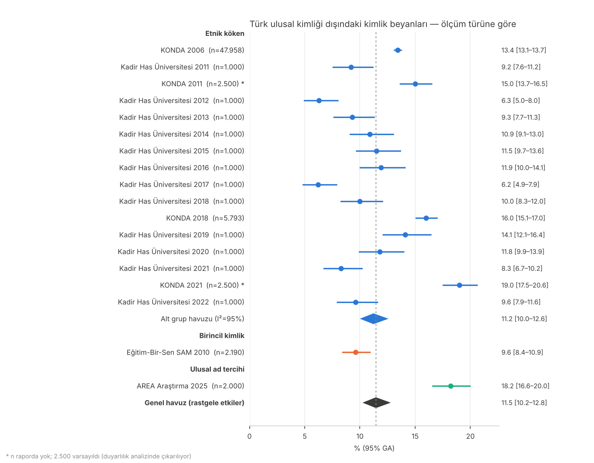
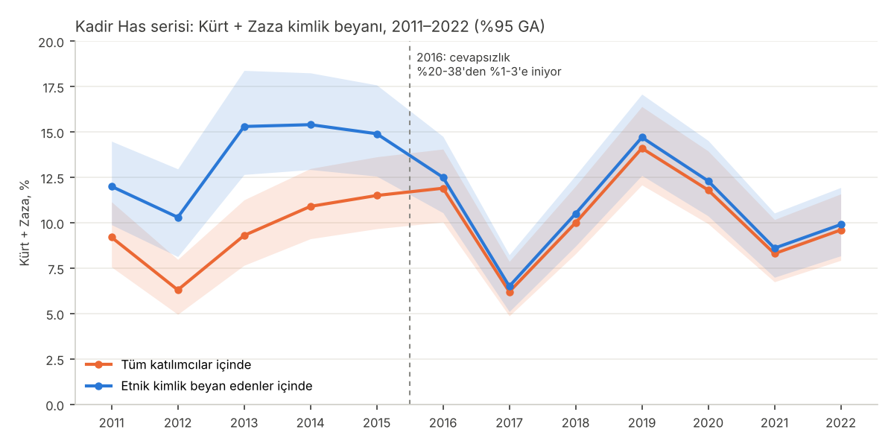

# Türkiye'de Ulusal Kimlik Beyanları: Bir Meta-Analiz (2006–2025)

*[English version](REPORT_EN.md)*

**Yazar:** Yusuf Onur Şimşek
**Kod ve veri:** `notebooks/analysis.ipynb`, `data/coding_table.csv`

> Bu meta-analiz sonuçları, *Marjinal* dergisinin "Türkiye'nin Ortak Kimliği ve Ortak Kimliğin Adlandırma Tartışmaları" adlı yazısının "Sosyolojik Açıdan Türkiyelilik" alt başlığındaki "Ampirik Sosyoloji: Türk Kimliğinin Toplumdaki Karşılığı" bölümünde değerlendirilmiştir. Yazının ilgili bölümüne ve tamamına ulaşmak için: https://marjinaldergi.com/yazilar/turkiyenin-ortak-kimligi-ve-ortak-kimligin-adlandirma-tartismalari/

## Yönetici özeti

- Türkiye'de kamuoyu araştırmalarında Türk ulusal kimliğinin dışında ya da karşısında konumlanan kimlik beyanlarının payı, 5 kurumun 18 bağımsız örnekleminde ortalama **%11,5** (%95 GA: 10,2–12,8).
- Bu pay **2006–2025 arasında artmıyor ya da azalmıyor** (yıllık eğilim p = 0,71). Alternatif kimlik beyanı istikrarlı bir azınlık olarak sürüyor.
- Sonucu en çok etkileyen şey zaman değil, **kurum ve soru tipi**. KONDA, aynı soruyu soran Kadir Has'a göre sistematik olarak daha yüksek Kürt beyanı ölçüyor (%15,7'ye karşı %9,8). Ulusal ad sorulduğunda ("Türk mü, Türkiyeli mi?") alternatif pay **%18,2'ye** çıkıyor.
- AREA 2025'te "Türkiyeli" tercih edenlerin payı, son dönemde etnik köken sorusuyla ölçülen Kürt/Zaza payından **5,8 puan daha yüksek** (p < 0,001). Yani "Türkiyeli" tercihi etnik Kürt beyanıyla sınırlı kalmıyor, onun ötesine geçen bir siyasi tutum.
- Kadir Has serisinde Türk kimliği beyanındaki büyük dalgalanmaların neredeyse tamamı **cevapsızlık oranındaki değişimden** kaynaklanıyor (r = −0,99). Alternatif kimliklerle anlamlı bir ilişkisi yok (r = 0,13; p = 0,69).

## 1. Araştırma sorusu

Kamuoyu araştırmalarında Türk ulusal kimliğinin dışında ya da karşısında konumlanan kimlik beyanlarının payı ne kadar? Bu pay zamanla değişiyor mu, ölçüm biçimine ve araştırma kurumuna göre farklılaşıyor mu?

"Alternatif/muhalif kimlik beyanı" üç ölçüm türünde kodlandı:

| Ölçüm türü | Kodlanan cevap | Çalışmalar |
|---|---|---|
| Etnik köken sorusu | Kürt (+ raporlandıysa Zaza) | Kadir Has 2011–2022 (12), KONDA 2006, 2011, 2018, 2021 |
| Birincil kimlik sorusu | Kürt + Alevi | Eğitim-Bir-Sen SAM 2010 |
| Ulusal ad tercihi | "Türkiyeli" | AREA Araştırma, 22–24 Ağustos 2025 |

## 2. Yöntem

- **Etki büyüklüğü:** Oran, logit dönüşümüyle (0,5 süreklilik düzeltmesi).
- **Model:** DerSimonian-Laird rastgele etkiler. Çalışmaların aynı popülasyonu farklı soru, kurum ve dönemlerle ölçtüğü varsayıldığı için sabit etkiler yerine rastgele etkiler seçildi.
- **Güven düzeyi:** %95 (kaynak araştırmaların raporladığı düzey). Tekil çalışmalarda Wilson aralığı kullanıldı.
- **Heterojenlik:** Cochran Q, I², τ² ve %95 tahmin aralığı.
- **Moderatörler:** Ölçüm türü ve kurum (alt grup analizi), yıl (meta-regresyon).
- **Duyarlılık:** Birini dışarıda bırak, varsayılan n'li çalışmaları çıkarma, geniş tanımlı çalışmayı çıkarma, Kadir Has'ı çıkarma.
- **Küçük çalışma etkisi:** Egger testi ve huni grafiği.

## 3. Bulgular

### 3.1 Genel havuz

| | k | Havuz % | %95 GA | Tahmin aralığı | I² |
|---|---|---|---|---|---|
| Tüm çalışmalar | 18 | 11,5 | 10,2–12,8 | 6,9–18,5 | %95 |

Heterojenlik çok yüksek (Q = 338,8; p < 0,001). Tek bir "gerçek oran"dan çok, ölçüme bağlı olarak %7 ile %18 arasında değişen bir aralık söz konusu.

### 3.2 Ölçüm türü ve kurum

| Alt grup | k | Havuz % | %95 GA |
|---|---|---|---|
| Etnik köken | 16 | 11,2 | 10,0–12,6 |
| Birincil kimlik | 1 | 9,6 | 8,5–10,9 |
| Ulusal ad tercihi ("Türkiyeli") | 1 | 18,2 | 16,6–20,0 |
| *Kadir Has* | 12 | 9,8 | 8,6–11,2 |
| *KONDA* | 4 | 15,7 | 13,4–18,3 |

Ölçüm türleri arasındaki fark anlamlı (Q_between = 75,4; p < 0,001). Kurumlar arasındaki fark da anlamlı (Q_between = 92,7; p < 0,001).

### 3.3 Zaman eğilimi (yalnızca etnik köken sorusu, k = 16)

| Model | Yıl katsayısı (logit) | p | Yıllık OR |
|---|---|---|---|
| Yıl | 0,01 | 0,71 | 1,01 |
| Yıl + KONDA | 0,02 | 0,17 | 1,02 |
| *KONDA etkisi* | *0,60* | *< 0,001* | *1,81* |

Kurum etkisi kontrol edildiğinde de anlamlı bir eğilim yok. KONDA'da bir kişinin kendini Kürt olarak beyan etme olasılığı (odds), Kadir Has'a göre yaklaşık 1,8 kat. Bunun muhtemel nedenleri: KONDA'nın daha geniş örneklemi ve kır-kent kapsamı (Kadir Has yalnızca 26 ilin kent merkezlerinde çalışıyor) ve soru ifadesindeki fark ("Kimliğinizi ne olarak biliyorsunuz veya hissediyorsunuz?").

### 3.4 Kadir Has serisi (2011–2022)

| | k | Havuz % | %95 GA | I² |
|---|---|---|---|---|
| Tüm katılımcılar içinde | 12 | 9,8 | 8,6–11,2 | %83 |
| Etnik kimlik beyan edenler içinde | 12 | 11,7 | 10,2–13,4 | %85 |
| 2011–2015 (beyan edenler) | 5 | 13,6 | 11,8–15,7 | %66 |
| 2016–2022 (beyan edenler) | 7 | 10,6 | 8,7–12,7 | %86 |

- Yıllık eğilim yok (p = 0,21).
- 2016'da "bilmiyorum/cevapsız" payı %20–38'den %1–3'e iniyor. Aynı yıl Türk beyanı %65,7'den %83,4'e çıkıyor. Bu bir ölçüm kırılması, toplumsal bir değişim değil.
- Türk beyanı ile cevapsızlık arasındaki ilişki: r = −0,99. Türk beyanı ile Kürt/Zaza beyanı arasında: r = 0,13 (p = 0,69).

### 3.5 "Türkiyeli" tercihi (AREA 2025)

| | % | %95 GA |
|---|---|---|
| AREA 2025, "Türkiyeli" | 18,2 | 16,6–20,0 |
| Etnik köken, 2018–2022 havuzu (Kürt/Zaza) | 12,4 | 10,0–15,3 |
| **Fark** | **+5,8 puan** | z = 3,61; p < 0,001 |

"Türkiyeli" tercih eden grup, etnik olarak Kürt beyan edenlerden anlamlı ölçüde büyük. Bu tercihin etnik kimliğin yanında siyasi ve ideolojik bir tutumu da yansıttığı anlaşılıyor; bu durum, yazıda tartışılan sol ve liberal çevrelerin Türkiyelilik vurgusuyla tutarlı. Sınırlılık: AREA telefonla (CATI) yapıldı, diğerleri yüz yüze. Ayrıca araştırma "Terörsüz Türkiye" sürecinin gündemde olduğu bir döneme denk geliyor.

### 3.6 Duyarlılık

| Analiz | k | Havuz % | %95 GA |
|---|---|---|---|
| Tümü | 18 | 11,5 | 10,2–12,8 |
| Varsayılan n'li KONDA 2011/2021 hariç | 16 | 10,8 | 9,6–12,2 |
| KONDA 2006 (geniş tanım) hariç | 17 | 11,3 | 9,7–13,1 |
| Yalnızca etnik köken | 16 | 11,2 | 10,0–12,6 |
| Kadir Has hariç | 6 | 15,0 | 12,9–17,3 |

Tek bir çalışmanın çıkarılması havuzu %11,1–11,8 aralığının dışına taşımıyor. Sonucu belirleyen, ağırlığın büyük kısmını oluşturan Kadir Has serisi.

### 3.7 Küçük çalışma etkisi

Egger testinde kesişim −2,62 (p = 0,08), yani sınırda. Bu çalışmalar yayımlanmış makaleler değil, kurumların düzenli kamuoyu araştırmaları; bu yüzden sonuç yayın yanlılığı olarak değil, büyük örneklemli KONDA araştırmalarının sistematik olarak daha yüksek oran ölçmesi (kurum etkisi) olarak okunmalı.

### 3.8 Ek bulgular

- **Alevi kimliği beyanı** (k = 6): %4,7 (%95 GA 4,1–5,4; I² = %54). Kadir Has'ta 2019'da %2,7 iken 2022'de %5,4.
- **Türk kimliği beyanı**: Etnik köken sorusunda %77,5, ulusal ad tercihinde ("Türk vatandaşı") %79,6, birincil kimlik sorusunda ise %52,6. Birincil kimlik sorusunda Türk kimliği büyük ölçüde Müslüman kimliğiyle (%32,9) paylaşılıyor. Bu, yazıdaki "iç içe geçmiş kimlik" tespitini destekliyor.

## 4. Sınırlılıklar

1. **Örneklem büyüklükleri:** KONDA 2011 ve 2021 için n raporlarda yok, 2.500 varsayıldı. Bu iki çalışma çıkarıldığında havuz %10,8'e iniyor.
2. **Farklı kavramlar:** Ölçüm türleri aynı kavramı ölçmüyor. Bu yüzden genel havuz tek başına değil, alt gruplarla birlikte okunmalı.
3. **Bağımsızlık:** Kadir Has serisi aynı kurumun tekrarlı kesitleri. Örneklemler bağımsız, ama yöntem ortak.
4. **Veri çıkarımı:** Bazı yıllar (özellikle 2011–2013) rapor grafiklerinden okundu. Kategori-yıl eşleştirmesinde küçük hata riski var.
5. **Eksik yıllar:** 2023–2024 Kadir Has raporlarına erişilemedi.
6. **Kapsam dışı kalanlar:** Çarkoğlu ve Toprak (2006), Kentel ve Ete (2022), CAP (2018) ve Pew (2025) kimliğin tanımını ya da önemini ölçtüğü, alternatif kimlik beyanının payını ölçmediği için havuza alınmadı.

## 5. Kaynaklar

Kodlama tablosundaki her satır kaynak bağlantısını içeriyor (`data/coding_table.csv`).
