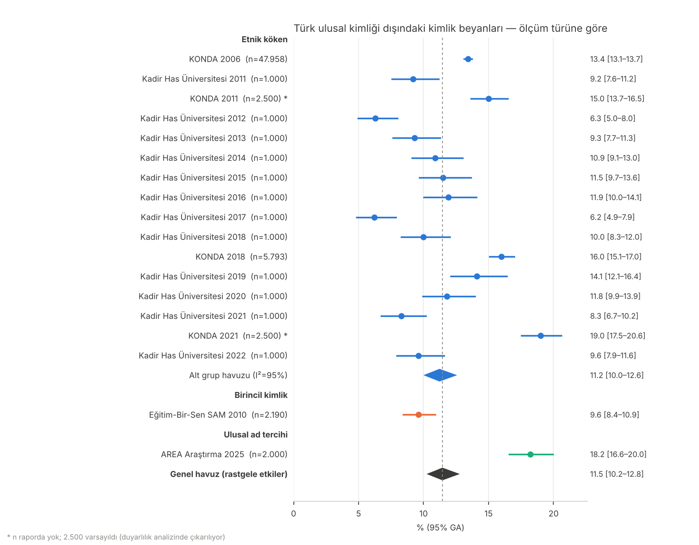
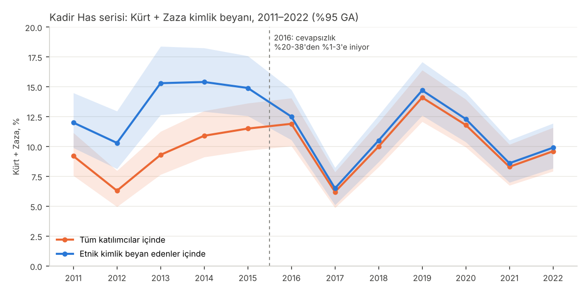

# National Identity Declarations in Turkey: A Meta-Analysis (2006–2025)

*[Türkçe sürüm](REPORT.md)*

**Author:** Yusuf Onur Şimşek
**Code and data:** `notebooks/analysis.ipynb`, `data/coding_table.csv`

> These meta-analysis results are discussed in the section "Empirical Sociology: How Turkish Identity Resonates in Society" (*Ampirik Sosyoloji: Türk Kimliğinin Toplumdaki Karşılığı*), under the subheading "Türkiyelilik from a Sociological Perspective" (*Sosyolojik Açıdan Türkiyelilik*), of the article "Turkey's Common Identity and the Debates over Naming It" (*Türkiye'nin Ortak Kimliği ve Ortak Kimliğin Adlandırma Tartışmaları*), published in *Marjinal* magazine (in Turkish). To read the relevant section and the full article: https://marjinaldergi.com/yazilar/turkiyenin-ortak-kimligi-ve-ortak-kimligin-adlandirma-tartismalari/

## Executive summary

- Across 18 independent samples from 5 institutions, the share of respondents in Turkish public opinion surveys who declare an identity outside of, or in opposition to, the Turkish national identity averages **11.5%** (95% CI: 10.2–12.8).
- This share **neither rises nor falls between 2006 and 2025** (annual trend p = 0.71). Alternative identity declaration persists as a stable minority.
- What moves the estimate most is not time but **survey institution and question type**. KONDA systematically measures higher Kurdish self-identification than Kadir Has, which asks the same question (15.7% vs 9.8%). When respondents are asked for a national label ("Türk or Türkiyeli?"), the alternative share rises to **18.2%**.
- In AREA 2025, the share preferring "Türkiyeli" is **5.8 points higher** than the recent Kurdish/Zaza share measured with the ethnic-origin question (p < 0.001). The "Türkiyeli" preference therefore extends beyond ethnic Kurdish identification and reflects a broader political stance.
- In the Kadir Has series, the large swings in "Turkish" self-identification are almost entirely driven by **changes in non-response** (r = −0.99). They show no significant association with alternative identities (r = 0.13; p = 0.69).

## 1. Research question

What share of respondents in public opinion surveys declare an identity outside of, or in opposition to, the Turkish national identity? Does this share change over time, and does it vary by measurement type and survey institution?

"Alternative/oppositional identity declaration" was coded across three measurement types:

| Measurement type | Coded response | Studies |
|---|---|---|
| Ethnic-origin question | Kurdish (+ Zaza where reported) | Kadir Has 2011–2022 (12), KONDA 2006, 2011, 2018, 2021 |
| Primary-identity question | Kurdish + Alevi | Eğitim-Bir-Sen SAM 2010 |
| National-label preference | "Türkiyeli" | AREA Araştırma, 22–24 August 2025 |

## 2. Methods

- **Effect size:** Proportion, logit-transformed (0.5 continuity correction).
- **Model:** DerSimonian-Laird random effects. Random rather than fixed effects were chosen because the studies measure the same population with different questions, institutions and periods.
- **Confidence level:** 95% (the level reported by the source surveys). Wilson intervals for individual studies.
- **Heterogeneity:** Cochran's Q, I², τ² and 95% prediction interval.
- **Moderators:** Measurement type and institution (subgroup analysis), year (meta-regression).
- **Sensitivity:** Leave-one-out; excluding studies with assumed n; excluding the broad-definition study; excluding Kadir Has.
- **Small-study effects:** Egger's test and funnel plot.

## 3. Findings

### 3.1 Overall pooled estimate

| | k | Pooled % | 95% CI | Prediction interval | I² |
|---|---|---|---|---|---|
| All studies | 18 | 11.5 | 10.2–12.8 | 6.9–18.5 | 95% |

Heterogeneity is very high (Q = 338.8; p < 0.001). Rather than a single "true rate", the estimate ranges between roughly 7% and 18% depending on how it is measured.

### 3.2 Measurement type and institution

| Subgroup | k | Pooled % | 95% CI |
|---|---|---|---|
| Ethnic origin | 16 | 11.2 | 10.0–12.6 |
| Primary identity | 1 | 9.6 | 8.5–10.9 |
| National-label preference ("Türkiyeli") | 1 | 18.2 | 16.6–20.0 |
| *Kadir Has* | 12 | 9.8 | 8.6–11.2 |
| *KONDA* | 4 | 15.7 | 13.4–18.3 |

The difference between measurement types is significant (Q_between = 75.4; p < 0.001), as is the difference between institutions (Q_between = 92.7; p < 0.001).

### 3.3 Time trend (ethnic-origin question only, k = 16)

| Model | Year coefficient (logit) | p | Annual OR |
|---|---|---|---|
| Year | 0.01 | 0.71 | 1.01 |
| Year + KONDA | 0.02 | 0.17 | 1.02 |
| *KONDA effect* | *0.60* | *< 0.001* | *1.81* |

There is no significant trend even after controlling for institution. In KONDA, the odds of a respondent identifying as Kurdish are about 1.8 times those in Kadir Has. Likely reasons: KONDA's larger samples and urban-rural coverage (Kadir Has surveys only city centres in 26 provinces), and differences in question wording ("What do you know or feel your identity to be?").

### 3.4 Kadir Has series (2011–2022)

| | k | Pooled % | 95% CI | I² |
|---|---|---|---|---|
| Among all respondents | 12 | 9.8 | 8.6–11.2 | 83% |
| Among those declaring an ethnic identity | 12 | 11.7 | 10.2–13.4 | 85% |
| 2011–2015 (declarers) | 5 | 13.6 | 11.8–15.7 | 66% |
| 2016–2022 (declarers) | 7 | 10.6 | 8.7–12.7 | 86% |

- No annual trend (p = 0.21).
- In 2016, the "don't know / no answer" share drops from 20–38% to 1–3%. In the same year, "Turkish" identification jumps from 65.7% to 83.4%. This is a measurement break, not a social change.
- Correlation between "Turkish" identification and non-response: r = −0.99. Between "Turkish" and Kurdish/Zaza identification: r = 0.13 (p = 0.69).

### 3.5 "Türkiyeli" preference (AREA 2025)

| | % | 95% CI |
|---|---|---|
| AREA 2025, "Türkiyeli" | 18.2 | 16.6–20.0 |
| Ethnic origin, 2018–2022 pool (Kurdish/Zaza) | 12.4 | 10.0–15.3 |
| **Difference** | **+5.8 points** | z = 3.61; p < 0.001 |

The group preferring "Türkiyeli" is significantly larger than the group identifying as ethnically Kurdish. This preference appears to reflect a political and ideological stance alongside ethnic identity, which is consistent with the emphasis on Türkiyelilik in left-wing and liberal circles discussed in the article. Limitation: AREA was conducted by telephone (CATI), while all others were face-to-face. The survey also coincided with a period when the "Terror-free Turkey" (*Terörsüz Türkiye*) process was on the public agenda.

### 3.6 Sensitivity

| Analysis | k | Pooled % | 95% CI |
|---|---|---|---|
| All | 18 | 11.5 | 10.2–12.8 |
| Excluding KONDA 2011/2021 (assumed n) | 16 | 10.8 | 9.6–12.2 |
| Excluding KONDA 2006 (broad definition) | 17 | 11.3 | 9.7–13.1 |
| Ethnic origin only | 16 | 11.2 | 10.0–12.6 |
| Excluding Kadir Has | 6 | 15.0 | 12.9–17.3 |

Removing any single study keeps the pooled estimate within 11.1–11.8%. The result is driven by the Kadir Has series, which carries most of the weight.

### 3.7 Small-study effects

Egger's intercept is −2.62 (p = 0.08), i.e. borderline. These studies are not published papers but regular public opinion surveys by institutions, so the result should be read not as publication bias but as the large-sample KONDA surveys systematically measuring higher shares (an institution effect).

### 3.8 Additional findings

- **Alevi identity declaration** (k = 6): 4.7% (95% CI 4.1–5.4; I² = 54%). In Kadir Has, it rises from 2.7% in 2019 to 5.4% in 2022.
- **Turkish identity declaration**: 77.5% with the ethnic-origin question and 79.6% with the national-label question ("Turkish citizen"), but 52.6% with the primary-identity question. In the primary-identity question, Turkish identity is largely shared with Muslim identity (32.9%). This supports the article's observation of a "nested identity".

## 4. Limitations

1. **Sample sizes:** n is not reported for KONDA 2011 and 2021; 2,500 was assumed. Excluding these two studies lowers the pooled estimate to 10.8%.
2. **Different constructs:** The measurement types do not measure the same concept, so the overall pool should be read together with the subgroups, not on its own.
3. **Independence:** The Kadir Has series consists of repeated cross-sections by the same institution. Samples are independent, but the methodology is shared.
4. **Data extraction:** Some years (especially 2011–2013) were read from report charts, so there is a small risk of category-year mismatches.
5. **Missing years:** The 2023–2024 Kadir Has reports could not be accessed.
6. **Out of scope:** Çarkoğlu and Toprak (2006), Kentel and Ete (2022), CAP (2018) and Pew (2025) were not pooled, because they measure how identity is defined or how important it is, not the share declaring an alternative identity.

## 5. Sources

Each row of the coding table includes its source link (`data/coding_table.csv`).
